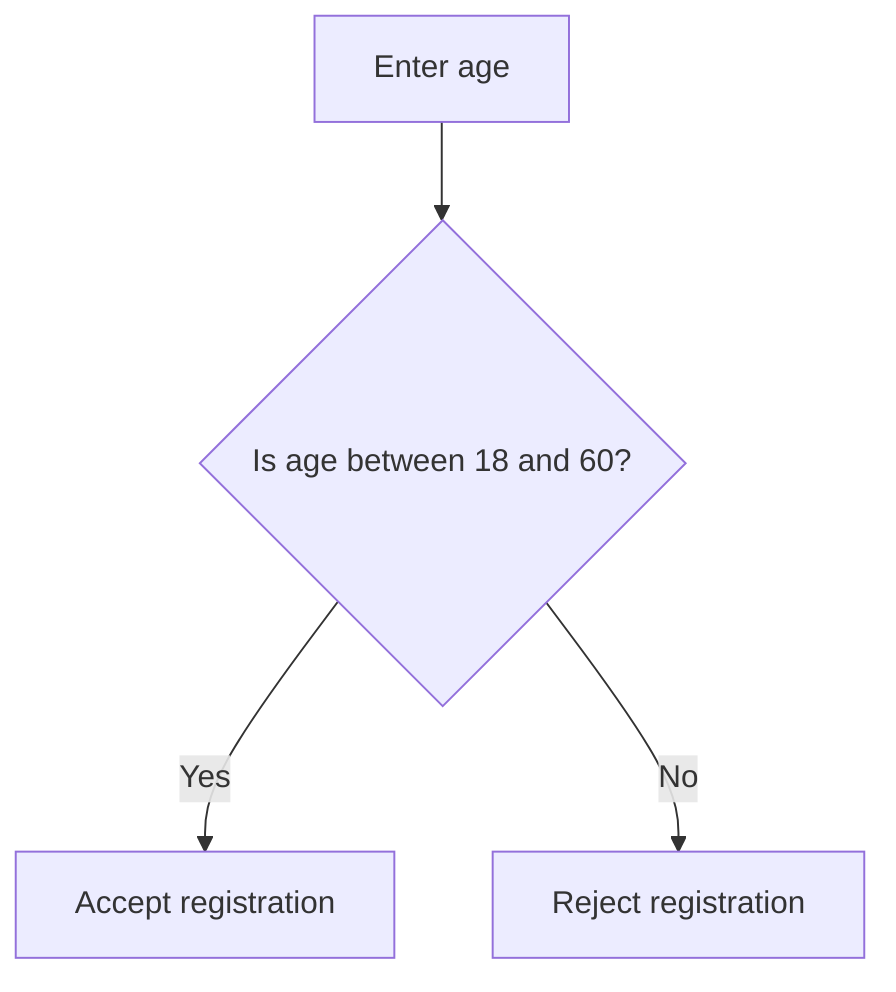
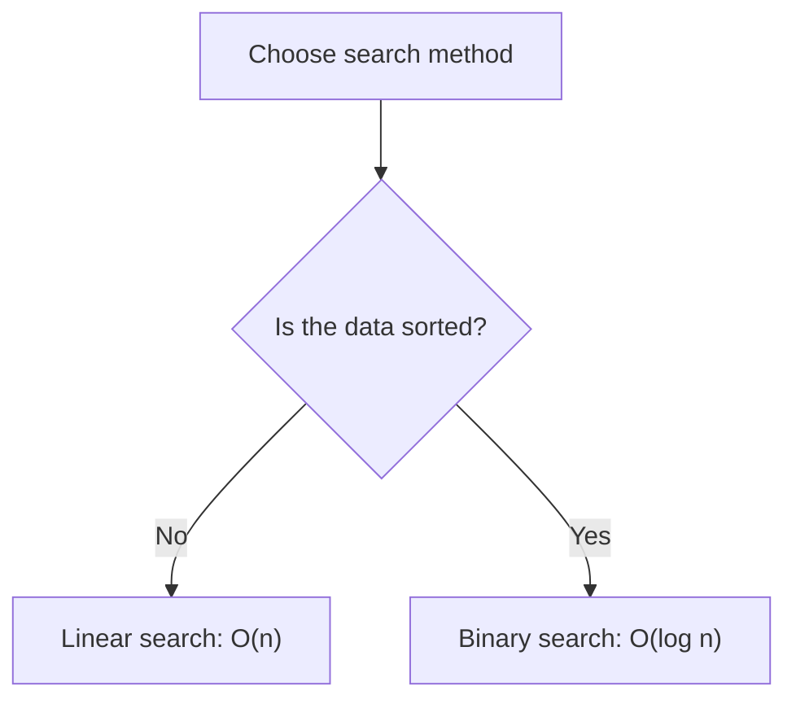
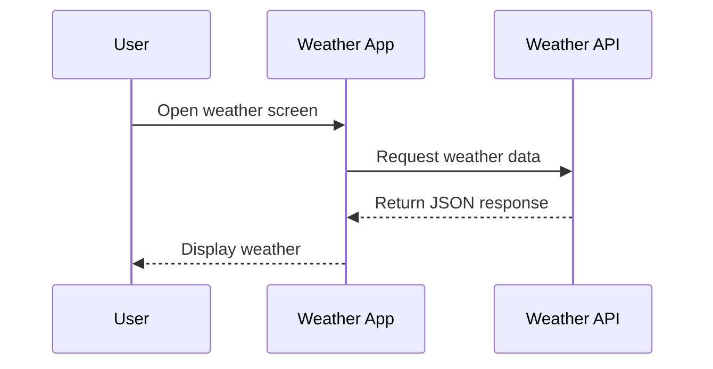
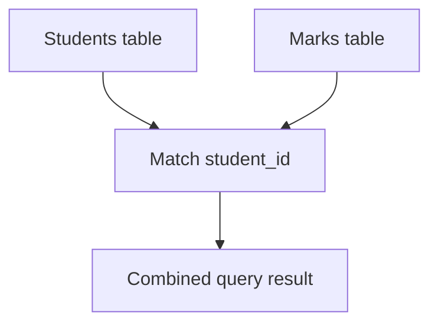
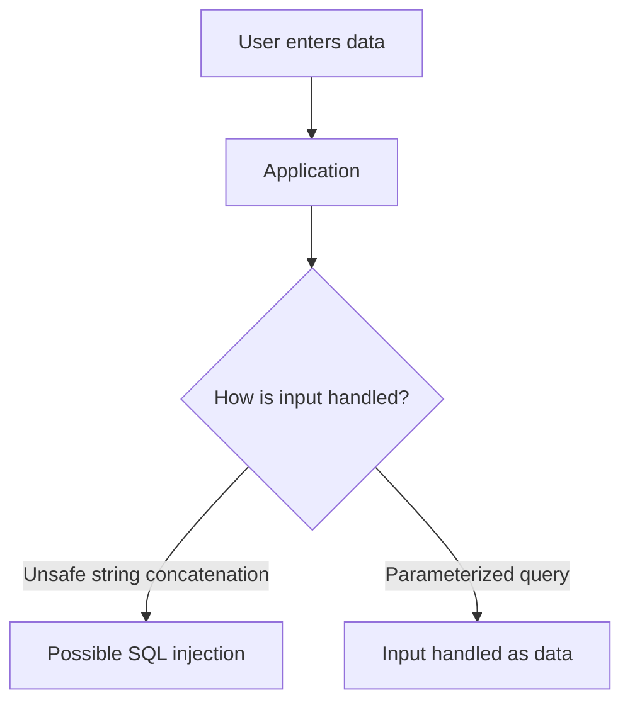

# Ganapa Updates — Weekly Learning Review
**October 11–16, 2026**

This week, I spent time learning and practising six useful topics: Boundary Value Analysis, Time Complexity, APIs and JSON, SQL JOINs, J-cuts and L-cuts, and SQL Injection.

These topics are useful in different areas of technology. Some help me write better code, some help me work with databases and APIs, and others help me improve my video editing. I also looked at practical examples to understand where these concepts are used in real life.

My goal is not just to remember definitions. I want to understand how things work, where they are useful, and how I can explain them to someone else.

---

## 1. Boundary Value Analysis

Boundary Value Analysis is a software testing technique. It focuses on testing the edges of an allowed range because mistakes often happen at the minimum and maximum values.

### Real-world example

Imagine a website that accepts registrations from people aged 18 to 60.

Instead of testing only ages like 25 or 35, I should test the values around both limits.

| Test input | Expected result |
|---|---|
| 17 | Rejected |
| 18 | Accepted |
| 19 | Accepted |
| 59 | Accepted |
| 60 | Accepted |
| 61 | Rejected |

This helps identify errors such as accidentally allowing someone under 18 or rejecting someone who is exactly 60.

### Diagram



### Practical question

If a form accepts marks from 0 to 100, which values would I test around the lower and upper limits?

**My takeaway:** Testing normal inputs is not enough. I should also test the values just outside and exactly on the boundaries.

---

## 2. Time Complexity

Time complexity helps me understand how an algorithm's running time grows as the amount of input increases. It helps compare solutions before choosing one.

### Real-world example

Imagine searching for a particular name in a list of student records.

- Linear search checks items one by one.
- Binary search repeatedly divides the search range in half, but it requires the data to be sorted.

For a sorted list of 1,000,000 items, binary search needs at most about 20 comparisons, while linear search can require up to 1,000,000 comparisons.

### Quick comparison

| Complexity | Meaning | Example |
|---|---|---|
| O(1) | Constant work | Accessing an array element by index |
| O(log n) | Grows slowly | Binary search on sorted data |
| O(n) | Grows with input size | Linear search |
| O(n²) | Can grow very quickly | Comparing every pair in a simple nested loop |

### Diagram



### Practical question

If an application searches through thousands of unsorted records, what would happen if the list became ten times larger? How might sorting the data change the search strategy?

**My takeaway:** A solution that works for a small input may become slow when the input grows. I should consider both correctness and efficiency.

---

## 3. APIs and JSON

An API allows different applications to communicate. JSON is a common format for exchanging structured data between them.

### Real-world example

Imagine opening a weather application. The app can request weather information from a weather service. The service sends back data, and the app displays the temperature and conditions.

A simplified JSON response might look like this:

```json
{
  "city": "Tumakuru",
  "temperature": 29,
  "condition": "Cloudy"
}
```

The application can read these fields and display them on the screen.

### Diagram



### Practical question

If I were building a college website, what information would the API need to return to display a student's name, course, and semester?

**My takeaway:** APIs help applications communicate, while JSON provides a structured way to exchange information. I need to understand both the request and the response.

---

## 4. SQL JOINs

SQL JOINs help combine related information stored in different database tables. They are useful when one table does not contain everything needed for a result.

### Real-world example

Imagine a college database with two tables.

**Students**

| student_id | name |
|---|---|
| 1 | Ravi |
| 2 | Priya |
| 3 | Kiran |

**Marks**

| student_id | marks |
|---|---|
| 1 | 85 |
| 2 | 92 |

To display students alongside their marks, I can use a JOIN.

```sql
SELECT Students.name, Marks.marks
FROM Students
INNER JOIN Marks
ON Students.student_id = Marks.student_id;
```

This returns Ravi with 85 marks and Priya with 92 marks. Kiran is excluded because there is no matching row in the Marks table.

If I want every student to appear even when marks are missing, I can use a `LEFT JOIN`.

```sql
SELECT Students.name, Marks.marks
FROM Students
LEFT JOIN Marks
ON Students.student_id = Marks.student_id;
```

Kiran will appear with `NULL` for marks.

### JOIN comparison

| JOIN type | What it returns |
|---|---|
| INNER JOIN | Only matching records |
| LEFT JOIN | All records from the left table and matching records from the right |
| RIGHT JOIN | All records from the right table and matching records from the left |
| FULL OUTER JOIN | All records from both tables, matching where possible; availability depends on the database |

### Diagram



### Practical question

How would I find every student who has not yet received marks? What condition could I add to the `LEFT JOIN` query?

**My takeaway:** JOINs let me retrieve related information without storing everything in a single table.

---

## 5. J-cuts and L-cuts in Video Editing

J-cuts and L-cuts are editing techniques that help audio and video flow naturally between two shots.

They are useful in interviews, short films, conversations, and creator videos.

### J-cut

The audio from the next scene starts before its video appears.

**Example:** I hear a friend begin speaking while the video still shows the previous shot. Then the video cuts to the friend.

### L-cut

The audio from the current scene continues after the video has changed to the next shot.

**Example:** A person finishes speaking while the video has already moved to another person's reaction.

### Simple timeline diagram

```text
J-CUT
Video: [Previous shot---------][Next shot------]
Audio: [Previous audio---][Next audio----------]

L-CUT
Video: [Previous shot---][Next shot------------]
Audio: [Previous audio---------][Next audio----]
```

### Practical question

If I am editing a conversation between two friends, where could I use a J-cut to make the next person's dialogue feel natural? Where could an L-cut help preserve an emotional moment?

**My takeaway:** Good editing is not only about changing shots. Audio timing can make a video feel smoother and more engaging.

---

## 6. SQL Injection

SQL Injection is a security vulnerability that can occur when an application combines untrusted user input directly into an SQL query.

It can allow an attacker to change the meaning of a database query. Learning how to prevent it is important when building login systems, websites, and other applications that use databases.

### Real-world example

Imagine a website with a login form. If the application directly inserts the entered username into an SQL query, specially crafted input might change how that query behaves.

An unsafe pattern looks like this:

```python
query = "SELECT * FROM users WHERE username = '" + username + "'"
```

The problem is that user input becomes part of the SQL command itself.

A safer approach is to use a parameterized query. For example, with Python's SQLite library:

```python
cursor.execute(
    "SELECT * FROM users WHERE username = ?",
    (username,)
)
```

The `?` is a parameter placeholder. The database treats the supplied username as data instead of treating it as part of the SQL command.

### Diagram



### Practical question

If I were building a login page, how would I make sure that usernames and passwords are handled safely? Why is checking the input alone not a substitute for parameterized queries?

**My takeaway:** Security should be part of development from the beginning. Parameterized queries are an important defence against SQL injection, and passwords should also be stored using an appropriate password-hashing method.

---

## What I learned this week

These six topics helped me look at technology from different angles.

Boundary Value Analysis taught me to test the edges, not just normal cases. Time Complexity helped me think about what happens when data grows. APIs and JSON showed me how applications exchange information. SQL JOINs helped me understand how related database records fit together. J-cuts and L-cuts showed me how audio and video timing can improve storytelling. SQL Injection reminded me that writing code also means protecting the people who use it.

I want to keep learning through examples, diagrams, practical questions, and small exercises. Understanding a concept is a good start, but being able to apply it to a real problem is what makes the learning useful.

**My thought for the week:**

> Learn the concept, understand the problem, practise with a real example, and explain it in your own words.

I will keep building on these lessons one day at a time, documenting what I actually learn and practise through Ganapa Updates.
