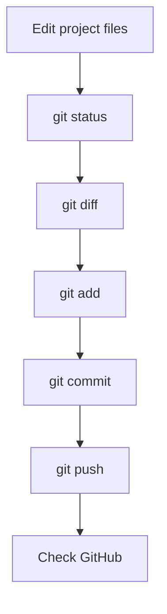

# Ganapa Updates — Daily Learning Topic
**October 27, 2026**

## Topic: Git and GitHub — From a Local Change to a Published Update

Git helps track changes in a project. GitHub hosts Git repositories online so developers can share code, review changes, and collaborate.

A useful habit is to check what changed before creating a commit. A commit is a saved snapshot in the project's history; pushing sends local commits to the remote repository.

## The basic workflow



## Commands to understand

Check the working tree:

```bash
git status
```

See the edits that have not been staged:

```bash
git diff
```

Stage a specific file rather than every file:

```bash
git add path/to/file
```

Create a commit with a meaningful message:

```bash
git commit -m "Explain the change"
```

Push the current branch to its remote:

```bash
git push
```

## Real-world example

Imagine fixing a bug in a calculator app. Before committing, check `git status` to see which files changed and `git diff` to review the exact edits. Stage only the intended file, commit the fix with a clear message, and push it so the update appears on GitHub.

This sequence makes it easier to catch accidental edits and understand the history later.

## Quick comparison

| Command | Purpose |
|---|---|
| `git status` | Shows changed, staged, and untracked files |
| `git diff` | Shows unstaged line-by-line changes |
| `git add` | Stages selected changes for the next commit |
| `git commit` | Saves staged changes in local history |
| `git push` | Sends local commits to a remote repository |

## Common mistake

A commit does not automatically mean the change is on GitHub. If the commit exists locally but has not been pushed, collaborators may not see it on the remote repository yet.

## Practice task

In a test repository, change one line in a README file and run the commands in order. Before committing, answer these questions:

1. What does `git status` show before and after `git add`?
2. How does `git diff` help you review a change?
3. What is the difference between committing and pushing?
4. How can you verify that the commit reached GitHub?

## Takeaway

**Review the change, stage only what you intend, write a clear commit message, push, and verify.** A reliable Git workflow is built on small, understandable updates—not on commits made just to create activity.

*This is a learning guide, not a claim that the practice task has been completed.*
