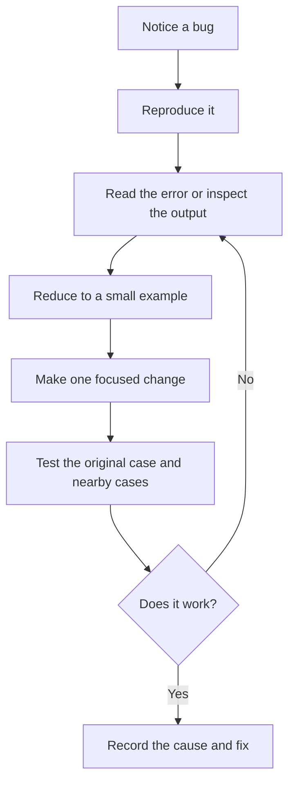

# Ganapa Updates — Daily Learning Topic
**October 28, 2026**

## Topic: Debugging with a Minimal Reproducible Example

When a program gives the wrong result or crashes, it is tempting to change several lines and hope the problem disappears. A better approach is to reproduce the problem, read the error, isolate the cause, and test one fix at a time.

A **minimal reproducible example** is the smallest piece of code that still shows the problem. It makes bugs easier to understand and easier for someone else to help solve.

## Real-world example

Suppose a Python program calculates the average of a list of marks:

```python
marks = [70, 80, 90]
average = sum(marks) / len(marks)
print("Average:", average)
```

This works for a non-empty list. But if `marks` is empty, `len(marks)` is zero and Python raises a `ZeroDivisionError`.

A small, explicit check handles that case:

```python
marks = []

if not marks:
    print("No marks available")
else:
    average = sum(marks) / len(marks)
    print("Average:", average)
```

The important part is not just adding a condition. It is identifying the exact input that causes the failure and checking that the fix handles both empty and non-empty lists.

## A simple debugging process



## Useful debugging habits

- Read the full error message and note the line where it occurred.
- Check the actual values of important variables before the failing line.
- Change one thing at a time so you can tell what fixed the issue.
- Test both the failing case and normal cases after making a fix.

## Practice task

Try the average example with `[70, 80, 90]`, then with an empty list. Observe what happens before and after adding the check.

1. What does the error message tell you?
2. What is the smallest input that reproduces the problem?
3. Which other edge cases should be tested?
4. How would you explain the cause and fix to a classmate?

## Takeaway

**Do not guess at a bug. Reproduce it, narrow it down, fix one cause, and test again.** Clear debugging habits save time and make code more reliable.

*This is a learning guide and practice task, not a claim that the task has been completed.*
